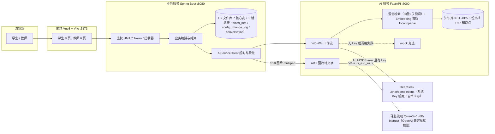
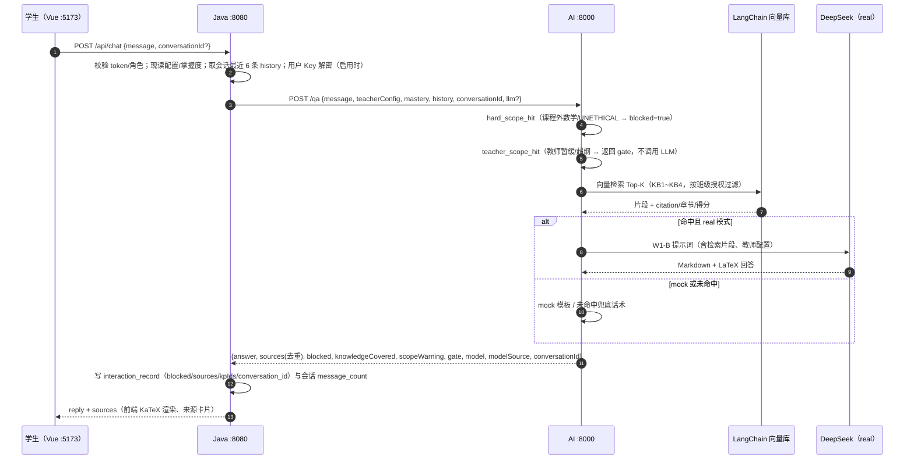
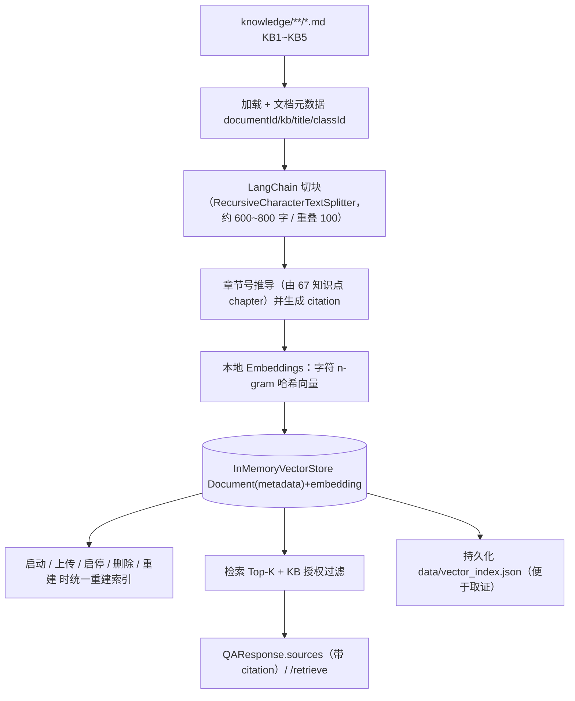
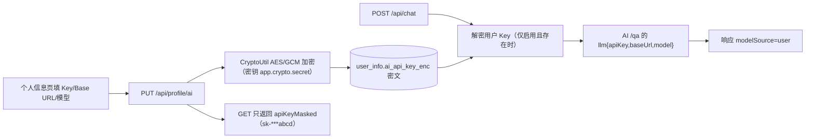
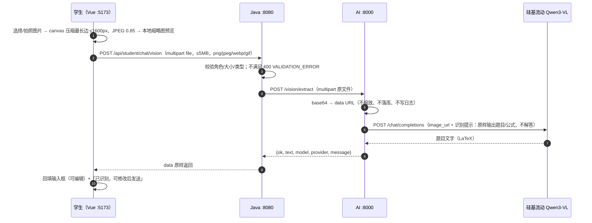
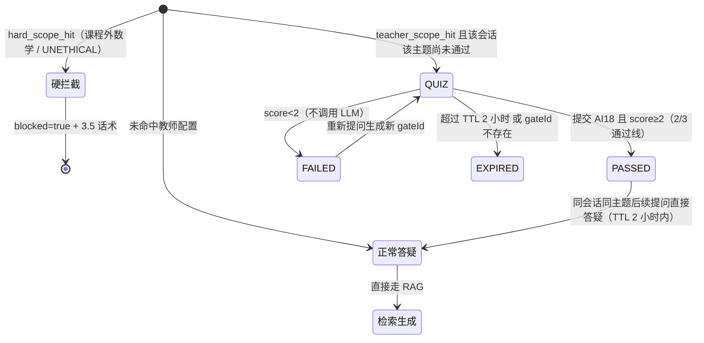
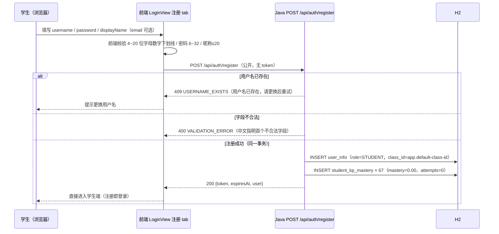
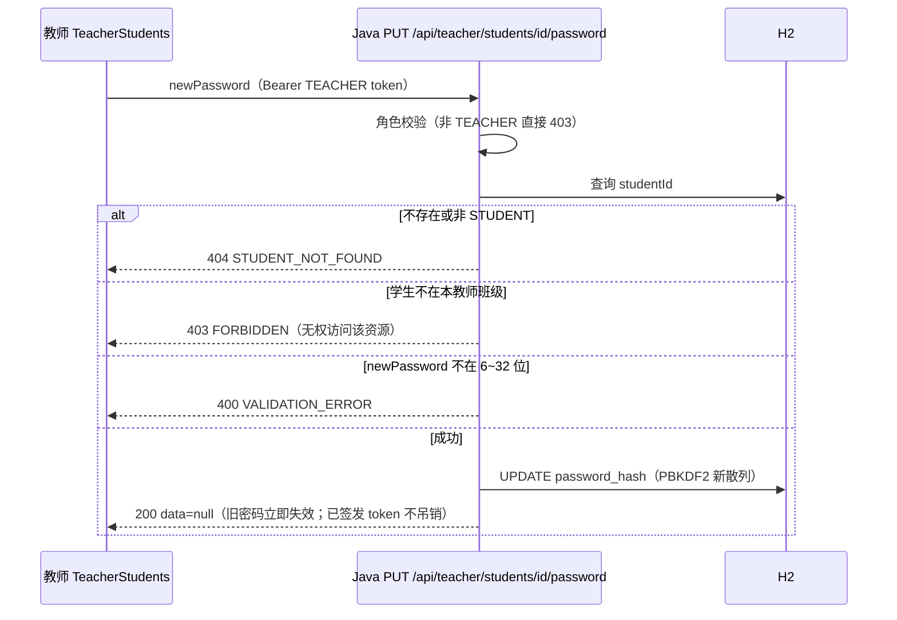
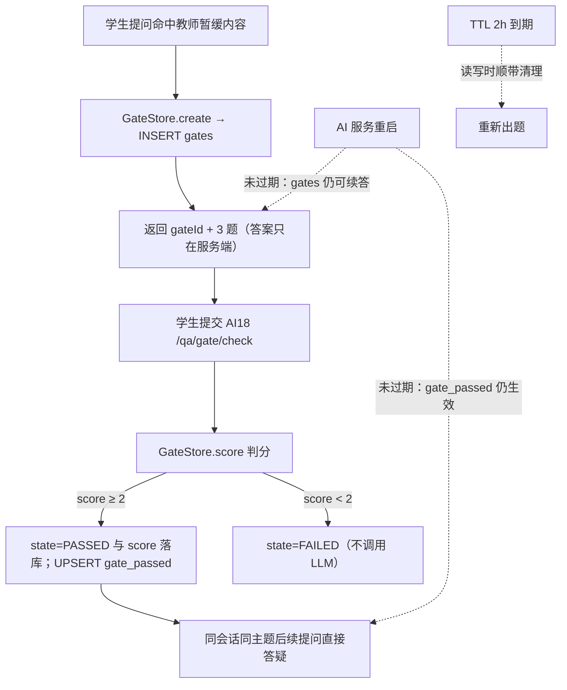

# 10 技术栈与架构说明

> 用途：课程提交与答辩用的**技术栈与架构总说明**：用了什么技术、为什么这么选、三端如何协作、关键数据如何流转。细节以各专项文档为准。
> 版本：v1.4（2026-11-08 09:57，已三端 real 实测：`acceptance_check.py` **24/24 PASS**；在 v1.3 图片转文字/前置自测 gate/硬拦截收窄基础上，增补学生自助注册 A19 与教师重置密码 A20）。契约以 [01-接口约定](01-接口约定.md) 为准（v1.2 增量见其 §10），实测以 [07-测试与验收记录](07-测试与验收记录.md) 为准（v1.2 见其 §9，已回填），部署步骤见 [06-部署与运行手册](06-部署与运行手册.md)。
> **当前状态**：v1.0、v1.1、v1.2 三轮均已实测（v1.2 于 2026-11-07 14:2x 以 real 模式完成三端复跑、14:5x 修复后再次复跑，两轮均 `acceptance_check.py` 20/20 PASS、AI 单测 42/42（16:4x 检索阈值校准后 **46/46**）、Java 19/19；详见 07 §9）。**15:0x 补测后全部实测项通过，16:4x 新增 V-27 阈值校准通过**；v1.2 补充界面截图（V12-01~05）经用户 2026-11-07 决定不拍摄（§11 已标注，不计为未取证项）；`openai` provider 回退（V-23，不可达地址验证回退分支）与用户 Key（V-20）、多轮（V-22）均已补测通过。v1.1：LangChain 向量检索 + 引用/范围字段，`acceptance_check.py` 20/20 PASS（real），AI 单测 35/35、Java 单测 15/15。
> **v1.3（图片转文字 + 前置自测 gate，2026-11-07 17:35 已实测通过）**：架构见 §4.9（图片链路）与 §4.10（gate 状态机），变更摘要见 §11.2，实测数字见 §11.3（已回填：22/22 PASS、AI 55/55、Java 25/25、前端 39/39；识图 15.25s/68 字、gate 出题 0.05s/通过 15.62s）；契约见 [01-接口约定](01-接口约定.md) §11。
>
> **v1.4（已完成，2026-11-08 09:57 三端 real 实测通过）**：学生自助注册（A19）与教师重置学生密码（A20）——注册流程与重置时序见 §4.11，变更摘要与实测数字见 §11.4；契约 `01` §12。验收 `acceptance_check.py` **24/24 PASS、退出码 0**（C-22/C-23 通过），Java 单测 30/30、前端 48 modules。
>
> **v1.4.1（gate 会话持久化，2026-11-08 已实测）**：前置自测（gate）与「已通过」标记由 Python 进程内存改为**本地 SQLite 持久化**（`ai-service/app/gate.py`，默认 `ai-service/data/gate.db`，可用 `AI_GATE_DB` 覆盖；TTL 仍 2 小时），**AI 服务重启后未过期的 gate 可继续作答、同会话同主题不再重复出题**，对外契约不变。设计见 §4.12，变更摘要与实测数字见 §11.5；配置/重置见 [06-部署与运行手册](06-部署与运行手册.md) §4.2/§9；验收记录见 [07-测试与验收记录](07-测试与验收记录.md) §12。

## 1. 总体架构



**三层职责一句话**：前端只做展示与交互；Java 是唯一业务数据入口与编排层；AI 服务只做「检索 + 生成 + 结构化输出」，不连业务库、不鉴权、不落业务数据。因此 AI 侧可独立替换（换模型、换检索方案）而不影响验收链路。

## 2. 技术栈清单

| 层次 | 技术 / 版本 | 选型理由 |
| --- | --- | --- |
| 前端 | Vue 3.5.13（Composition API）、Vite 6.4.3、marked 18.1.1、KaTeX 0.19.1 | 构建快、学习成本低；不引入 vue-router，App.vue 内状态切页，减少联调风险 |
| 前端请求 | 原生 `fetch`（`src/api.js` 封装） | 统一 Bearer token、401 跳登录、错误 toast、统一响应解包 |
| 业务服务 | Java 17、Spring Boot 3.4.2（Web / Data JPA / Validation / Actuator）、H2 文件库 | 课程主线技术栈；不新增第三方依赖：token 用 JDK HMAC-SHA256、密码 PBKDF2、HTTP 用 JDK `HttpClient`，受限网络下可离线构建 |
| 业务数据 | H2 `jdbc:h2:file:./data/student-project;AUTO_SERVER=TRUE`，`ddl-auto=update` | 免装数据库、换机可复现；`AUTO_SERVER` 允许 H2 控制台与程序同时连接；空库自动导入演示数据 |
| 安全 | Spring Security 不引入；HMAC-SHA256 token（`TokenService`）、PBKDF2 密码（`PasswordHasher`）、**AES/GCM 加密用户 AI Key（`CryptoUtil`，密钥 `app.crypto.secret`）** | 课程环境少依赖、可离线；用户 Key 只存密文、只回掩码、不写日志 |
| AI 服务 | Python 3.12.3、FastAPI 0.162.0、uvicorn 0.54.0、Pydantic 2.14.1、httpx 0.28.1 | 异步接口 + Pydantic 校验；httpx 调 DeepSeek 并带超时 |
| RAG 检索（v1.1，v1.2 增强） | `langchain-core` 1.7.6、`langchain-text-splitters` 1.1.3、InMemoryVectorStore + 本地 `Embeddings`、numpy 2.5.4；**v1.2 增加混合检索（向量+关键词）、查询归一化/扩展、`chunkId` 去重、`EMBEDDING_PROVIDER=local\|openai` 可插拔** | 体现 LangChain 使用；本地字符 n-gram 哈希向量离线、确定、可复现；DeepSeek 无 embeddings 接口（实测 404），故默认本地实现、外部服务可选并可回退 |
| 检索对照/降级 | 保留 `app/retrieval.py`（字符 bigram + TF-IDF 余弦 + 术语加权） | v1.0 已验收的实现，作对照与降级；向量索引异常不影响服务可用 |
| LLM | DeepSeek（OpenAI 兼容 `POST {BASE_URL}/chat/completions`，`.env` 实测 `deepseek-flash`，可选 `deepseek-v4-pro`） | 中文与公式表达好、成本低、OpenAI 兼容便于替换；模型名以 `DEEPSEEK_MODEL` 为准 |
| 图片识别（v1.3） | 硅基流动 OpenAI 兼容视觉模型 `Qwen/Qwen3-VL-8B-Instruct`（可选 32B），httpx 转发 base64 data URL | DeepSeek **无 vision 接口**（实测 `/models` 仅 chat 模型）；复用 `.env` 的 `EMBEDDING_API_KEY`；未配置/失败返回 `ok=false`，前端提示改用文字输入，不影响主链路 |
| 运行模式 | `AI_MODE=auto`（`.env` 有 key 即 real，无 key 自动降级 mock）/ `mock` / `real` | 有网演示真实效果，无网或无 key 仍能全链路验收 |
| 文档与脚本 | Markdown、PowerShell/BAT（`chcp 65001`）、Python 标准库 `urllib` 验收脚本 | 无额外安装成本；验收脚本零依赖，装了 Python 即可跑 |
| 测试 | JUnit（Spring Boot Test）、Python `unittest`、`scripts/acceptance_check.py` | 单元 + 接口 + 三端验收三层覆盖 |

## 3. 三服务模块职责

### 3.1 前端 `frontend/`

```text
src/
├─ App.vue               单页切页 + 左侧导航（学生 8 项 / 教师 5 项）
├─ api.js                fetch 封装：baseURL、Bearer、统一响应、401 处理
├─ toast.js / utils/     轻提示、日期与百分比格式化
├─ components/           MarkdownView（marked+KaTeX）、MasteryBars、Toast、Skeleton、Empty、Error
├─ views/LoginView.vue   登录（演示账号一键填充）
├─ views/student/        Home / Tutor / Diagnose / Plan / Practice / Records / Wrong / Profile
└─ views/teacher/        Home / Config / Analysis / Knowledge / Students
```

- 只调 Java `/api/*`，不直连 8000；字段以 `docs/开发过程/01` 为准，对 v1.1 新增字段缺失时按默认值降级。
- v1.1 新增：来源卡片显示 `citation`（《文档》第X章·第Y节 知识点）；答疑展示 `scopeWarning` 与「知识库未覆盖」提示；教师知识库页增加「向量库状态卡」。
- **v1.3 新增**：答疑页输入区「图片」按钮（canvas 压缩 ≤1600px → S18 → 回填文字，可编辑后再发送）；前置自测 gate 卡片（3 道单选、提交 S19、通过后展示三步骤教学、失败可重测、过期提示）；样式 `.gate-card`、`.vision-preview`。
- **v1.2 新增**：顶栏「AI 模式徽标」（`utils/aiMode.js` + `common.health()`：`real · deepseek-flash · 系统 Key` / `real · 我的 Key` / `mock`）；答疑页会话列表（新建/切换/重命名/删除）与「继续对话」；个人信息/教师个人信息「AI 模型设置」卡（`components/AiModelSettings.vue`）；来源卡片「知识库来源（N 段）」去重说明。

### 3.2 业务服务 `business-service/`

```text
com/dongchen/campus/
├─ common/      ApiResponse、ErrorCode、BusinessException、GlobalExceptionHandler、PageResult、JsonHelper、CryptoUtil（AES/GCM）
├─ config/      WebConfig（拦截器/CORS）、Auth/Ai/App/Crypto 配置、ReadOnlyDatabaseRepairListener（H2 只读自愈）
├─ security/    AuthInterceptor、TokenService（HMAC-SHA256）、PasswordHasher（PBKDF2）、UserContext
├─ domain/      7 核心表实体 + ClassInfo + ConfigChangeLog + Conversation（v1.2）+ 枚举（Role/AnswerMode/ReportType 等）
├─ repository/  9 个 Spring Data JPA 仓储
├─ ai/          AiServiceClient（JDK HttpClient，超时与降级）
├─ service/     Auth / Chat / Diagnose / Practice / Plan / Teacher / Student / Knowledge / Mastery / Meta / ReportMapper / **Conversation / ProfileAi / Health（v1.2）**
├─ web/         Auth/Chat/Diagnose/Practice/Plan/Student/Teacher/Knowledge/Meta + **Profile/Conversation（v1.2）** 控制器 + DTO
└─ seed/        DemoDataSeeder（2 班 2 师 5 生 67 知识点 + 演示数据）、KnowledgePointSeeder
```

关键点：

1. **鉴权**：`AuthInterceptor` 校验 Bearer token 并写入 `UserContext`；角色越权返回 `403 FORBIDDEN`。
2. **配置实时读**：学生每次请求现查 `class_teacher_config`，不缓存旧值，教师修改后新请求立即生效（8.2-3）。
3. **掌握度结算**：答对 +0.05、答错 -0.1，clamp 到 0~1；诊断/练习结果同步写 `student_kp_mastery`、`wrong_question`、`report`，学生端与教师端同源（8.1-4 / 8.1-6）。
4. **AI 调用降级**：AI 服务异常时不让前端 500 或白屏，返回可读提示；超时可配。
5. **v1.1 透传**：`ChatService` 读取 AI 返回的 `knowledgeCovered`（缺省 true）与 `scopeWarning`（可空）写入返回结果；`sources` 为 `List<Object>` 透传，`citation/chapter/section` 自动进入交互记录与前端，不改表结构。
6. **v1.3 新增**：S18 图片转发（`multipart`，≤5MB、类型校验，AI 不可达 503）、S19 gate 提交（校验会话归属、转发 AI18、通过/失败都落库两条消息并写 `gate_json`）；`ChatService` 透传 AI 的 `gate`；`/api/health` 透传 `vision{provider,model,ready}`。

### 3.3 AI 服务 `ai-service/`

```text
app/
├─ config.py       环境与模式（AI_MODE / DeepSeek / 分块 / 检索参数 / EMBEDDING_* / QUERY_EXPANSION）、5 份内置文档定义
├─ schemas.py      Pydantic 入出参（QA / Diagnose / Practice / Plan / Knowledge / Health）
├─ kp.py           67 知识点元数据、名称/别名匹配
├─ knowledge.py    文档加载、章节识别、切块、启停/上传/删除状态持久化
├─ retrieval.py    v1.0 轻量检索（bigram + TF-IDF），v1.1 保留作对照与降级
├─ query.py        v1.2 查询归一化 / 同义扩展 / real 模式查询改写（改造新增）
├─ embeddings.py   v1.1 本地字符 n-gram 哈希 Embeddings；v1.2 双轨（local / openai 兼容，失败回退 local）
├─ vector_store.py v1.1 LangChain InMemoryVectorStore 封装 + 持久化（改造新增）
├─ rules.py        边界拦截、引导式（不给答案）、意图规则
├─ builtin_questions.py  题库与分层出题
├─ prompts.py      W0~W4 提示词模板
├─ mock.py         mock 应答（离线确定性）
├─ llm.py          DeepSeek 调用、JSON 解析与重试、降级
├─ service.py      检索 / 答疑 / 诊断 / 练习 / 计划 / 配置 / 学情编排
├─ routers/ai.py、routers/knowledge.py   FastAPI 路由
└─ main.py         装配：CORS、路由、启动重建索引、UTF-8 JSON
```

> v1.1 的 `embeddings.py` / `vector_store.py`、v1.2 的 `query.py` 均以仓库实际文件为准；`retrieval.py` 保留不删，作对照与降级。
>
> **v1.3 新增能力**：`POST /vision/extract`（图片转文字，硅基流动视觉模型，未配置返回 `ok=false`）、`POST /qa/gate/check`（GateStore 判分 + 三步教学，通过线 2/3、TTL 2 小时）；`rules.py` 拆为 `hard_scope_hit()`（硬拦截）与 `teacher_scope_hit()`（教师配置 → gate）；`/qa` 响应新增 `gate`，`/health` 新增 `vision_provider/vision_model/vision_ready`。具体文件名以仓库实现为准。

## 4. 关键数据流

### 4.1 答疑主链路（8.1-1 / 8.1-2 / 8.2-1 / 8.2-2）



行为矩阵（v1.3 五类，完整定义见 `docs/开发过程/01` §3.7，硬拦截话术逐字不变）：

| 场景 | blocked | knowledgeCovered | gate | sources | 回答 |
| --- | --- | --- | --- | --- | --- |
| a 硬拦截：课程外数学（线代/矩阵/概率论/物理/复变/数分/离散）、UNETHICAL | true | false | null | 空 | 契约统一话术原文（不产生 gate） |
| b 教师配置暂缓/超纲：`disabledTopics`、范围外知识点、`boundaryRules` | false | false | `state=QUIZ` | 空 | gate 说明话术，不调用 LLM；通过后三步教学 |
| c 非数学无关问题（英语/政治/编程/生活） | false | false | null | 空 | 有帮助的通用回答 + 固定范围提醒 |
| d 数学在范围内但知识库未命中 | false | false | null | 空 | 「知识库暂无相关内容」+ 换问法建议 |
| e 命中 | false | true | null | 带 `citation` | 结合资料的分层讲解 |

### 4.2 知识诊断（8.1-4）

`S10 /api/diagnose/start` → Java 建 `report(type=DIAGNOSIS, status=IN_PROGRESS)`（`sessionId=reportId`）→ AI `/diagnose/questions` 出 5/15 题（学生侧不含 `answerKey/analysis`）→ `S11 /submit` → AI `/diagnose/grade` 逐题判分与错因归类 → Java 更新 `student_kp_mastery`、写 `wrong_question`、报告转 `COMPLETED` → 学生端与教师端同源可见。

### 4.3 分层练习与学习计划（8.1-5）

- 练习：`S12 /practice/generate` → AI `/practice/questions`（A/B/C 分层，难度 clamp 到教师 `maxDifficulty`）→ Java 存 `report(type=PRACTICE)`，`batchId="PB"+report.id`；`S13 /practice/hint` 只给下一步思路，不给答案。
- 计划：`S14 /plans/generate` → AI `/plan` → Java 存 `report(type=PLAN)`，返回 `days[{study,practice,review,goal}]`；`S15~S17` 列表 / 详情 / 打卡。

### 4.4 知识库导入与向量检索（v1.1）



要点：

1. **离线可复现**：Embeddings 用本地字符 n-gram 哈希（非外部 API），同语料同查询结果稳定，便于课堂演示与单测。
2. **元数据完整**：`Document.metadata` 带 `documentId/kb/title/chapter/section/kpId/heading`，检索结果可直接拼 `citation`。
3. **索引生命周期**：启动、上传、启停、删除、手动重建后统一走同一重建入口，保证向量库与文件状态一致。
4. **可观测**：`/health` 增加 `vector_store/embedding/vector_dim/vector_count`；教师知识库页展示向量库状态卡；`ai-service/scripts/vector_demo.py` 可命令行演示导入与检索命中章节。
5. **降级**：向量索引构建失败时回退 `retrieval.py` 轻量检索，接口不 500（与 `AI_MODE` 降级相互独立）。

### 4.5 教师配置即时生效（8.2-3）

教师 `PUT /api/teacher/config` → 写 `class_teacher_config` + `config_change_log`（变更前后留痕）→ **不通知、不缓存**；学生下一次请求 Java 现读配置 → 注入 AI `teacherConfig` → AI 提示词与后置校验按新边界执行。`C-15`（改难度后新题 ≤ 新上限）与 `C-16`（禁用话题被拦截）即验证此链路。

### 4.6 多轮会话上下文（v1.2）

1. 学生在答疑页新建会话或从学习记录点「继续对话」→ 前端持有 `conversationId`；
2. `POST /api/chat {message, conversationId?}`：无 id 时 Java 新建 `CONVERSATION`（title=消息前 20 字），有 id 时校验属于本人；
3. Java 取该会话最近 **6 条**消息（user/assistant 正序）作为 `history` 传 AI；AI 侧再截断到 8 条 / 4000 字符；
4. AI 将 history 拼入 W1-B 提示词（理解「它/那这个条件呢」等指代）；mock 模式也在回答中体现「结合上文」；
5. 回答落库时写 `interaction_record.conversation_id`，并 `message_count += 2`；`GET /api/conversations/{id}` 返回全部消息（含 sources/blocked）；
6. 越权保护：他人会话或教师访问 → 403；删除会话仅删本人数据。

### 4.7 用户 Key 加密链路（v1.2）



要点：Key 只存密文；接口只回掩码；日志与异常信息不得打印 Key；`llm` 仅本次请求使用，AI 不回显、不落库；用户 Key 调用失败自动降级系统 Key（`modelSource=system`），再失败降级 mock。

### 4.8 Embedding 双轨与检索增强（v1.2）

| 轨 | 配置 | 行为 |
| --- | --- | --- |
| A（默认） | 不配置额外项 | 查询归一化 + 规则同义扩展 + real 模式 DeepSeek 查询改写 + 混合检索（向量+关键词）+ `chunkId` 去重 |
| B（可选） | `EMBEDDING_PROVIDER=openai` + `EMBEDDING_BASE_URL/API_KEY/MODEL` | 调用 OpenAI 兼容 `/embeddings` 生成向量；缺 key、超时或报错自动回退 A（`/health` 显示 `embedding_provider=local`） |

事实依据：DeepSeek 无 embeddings 接口（`POST /embeddings` → 404，`/models` 仅 deepseek-flash/deepseek-v4-pro，2026-11-07 实测），因此默认用本地哈希向量保证离线可复现，外部 embedding 作为可选增强。

**阈值随方案切换（v1.2 实测校准）**：两种向量的分数分布不同，不能用同一阈值判「知识库是否覆盖」——`local` 对无关问题分数接近 0，用 `RETRIEVAL_MIN_SCORE`（默认 `0.15`）；`openai`（bge-m3 等语义模型）对无关问题也给 **0.28~0.39**、相关问题 **0.70~0.99**，用 `EMBEDDING_MIN_SCORE`（默认 `0.40`）。取值入口：`config.settings.effective_min_score()` 与 `vector_store.VectorIndex.default_min_score()`；`/retrieve` 的 `minScore` 可选，不传按方案默认（单测 `test_45_min_score_depends_on_embedding_provider`、`test_46_retrieve_default_threshold_follows_scheme`）。

### 4.9 图片转文字链路（v1.3）



要点：① 图片只存在于本次请求内存中，**不落库、不参与多轮历史**，发送时按普通文字；② `VISION_PROVIDER=none` 或未配 key → `ok=false` +「未配置识图模型…」，前端提示改用文字输入；③ 视觉模型失败/超时 → `ok=false` +「图片识别失败，请重试或改为文字输入。」，不影响文字答疑主链路。

### 4.10 前置自测 gate 状态机（v1.3）



要点：① 出题固定 3 道单选，取自主题章节之前的前置知识点，正确答案只存 AI 侧 `GateStore`；② `PASSED` 由 DeepSeek 生成「第 1 步/第 2 步/第 3 步」教学（不给作业最终答案、带 citation），失败降级 mock 模板；③ `FAILED` 仅给反馈与薄弱知识点，可重新提问重测；④ 硬拦截（矩阵等）永不出 gate。

### 4.11 用户自助注册与教师重置密码（v1.4，已完成实测）

> 契约见 [01-接口约定](01-接口约定.md) §12；状态：**已完成并实测通过（2026-11-08 09:57，三端 real，24/24 PASS；C-22/C-23 见 `docs/开发过程/07` §11，实测数字见 §11.4）**。本小节时序按契约绘制。

**（1）学生自助注册 A19**（注册即登录；默认班级由服务端决定）：



**（2）教师重置学生密码 A20**（校验顺序：404 → 403 → 400，避免用差异码枚举他班学生）：



要点：

1. **注册即登录**：A19 响应与 A1 同构（`{token,expiresAt,user}`），前端拿到 token 直接进学生端，不做二次登录；响应必须复用 A1 的 `user` 序列化入口。
2. **默认班级服务端定**：请求不带 `classId`；后端读 `app.default-class-id`（默认 `C-GS-01`），班级缺失按部署错误返回 500，不静默落到其他班级。
3. **67 条掌握度同事务初始化**：与建账号同一事务，任一失败整体回滚；缺行会导致学生端首页/诊断/练习统计为空或偏差。
4. **密码存储与不回显**：注册与重置共用 `security/PasswordHasher`（PBKDF2WithHmacSHA256，120000 次、16 字节盐、256 位），接口、日志、异常均不得出现明文或散列值。
5. **token 不吊销是明确取舍**：无状态 HMAC 令牌（7 天）不维护黑名单，重置密码只让旧密码在下次登录时失效；已签发 token 到期前仍可用，前端引导重新登录属 UI 行为。强制下线属 P2（`user_info.token_version` 或黑名单），`01` §12.4 已写明。

### 4.12 前置自测（gate）状态持久化（v1.4.1，已完成实测）

> 状态：**已完成并实测（2026-11-08）**。v1.3 的 gate 与「已通过」标记只存在 Python 进程内存：AI 服务一重启，正在做的 gate 直接失效、已通过的会话重新弹题。v1.4.1 把这两类状态落到**本地 SQLite**，对外接口与状态机（§4.10）完全不变；契约行为说明见 [01-接口约定](01-接口约定.md) §12.8，实测见 [07](07-测试与验收记录.md) §12。



**（1）存储位置与配置**

| 项 | 值 | 说明 |
| --- | --- | --- |
| 代码 | `ai-service/app/gate.py`（`GateStore`） | 标准库 `sqlite3`，无新增第三方依赖 |
| 默认库文件 | `ai-service/data/gate.db` | 首次启动自动建目录与表；与 `knowledge_state.json` 同目录，已被 `.gitignore` 覆盖 |
| 覆盖环境变量 | `AI_GATE_DB` | 读取于 `ai-service/app/config.py` 的 `settings.gate_db_file`（默认 `data/gate.db`）；测试用临时库或多实例隔离时设置 |
| TTL | 2 小时（`GATE_TTL_SECONDS = 2 * 3600`） | 与 v1.3 一致；过期数据在每次读写时顺带清理，不依赖定时任务 |
| 打开失败 | 回退 `:memory:` | 目录不可建或 `sqlite3.Error` 时记日志并退化为内存模式，答疑主链路不中断（重启后行为同 v1.3） |

**（2）表结构（两表，见 `gate.py` 的 `_SCHEMA`）**

| 表 | 字段 | 说明 |
| --- | --- | --- |
| `gates` | `gate_id` TEXT PK、`topic`、`reason`、`conversation_id`、`topic_kp_ids`、`prerequisites`、`questions`（JSON 文本）、`created_at` REAL、`state`、`score` | 一次出题一行；**正确答案随 `questions` JSON 只存服务端**，任何接口都不返回 `answerKey`；索引 `idx_gates_created_at(created_at)` |
| `gate_passed` | `conversation_id`、`topic`、`expires_at` REAL，主键 `(conversation_id, topic)` | 「该会话该主题已通过」标记；通过时 UPSERT `expires_at = now + TTL`；索引 `idx_gate_passed_expires(expires_at)` |

**（3）实现要点**

1. 连接参数：`check_same_thread=False` + `timeout=10.0` + 模块内 `threading.Lock` 串行化；文件库设 `PRAGMA journal_mode=WAL`、`PRAGMA synchronous=NORMAL`（`:memory:` 不设 WAL）。
2. 方法集：`create` / `get` / `is_passed` / `mark_passed` / `score` / `clear` / `close`，路由层（AI18 与 `/qa`）调用面与 v1.3 相同，只换存储实现。
3. **`database is locked` 的根因修复**：清理过期行的 `DELETE` 会隐式开启写事务，之前只在删到行时才提交；现在 `_purge_locked()` **无论是否删到行都 `commit()`**，避免另一实例或重启前旧进程读写时拿不到锁。
4. 重启恢复路径：`get(gateId)` 命中且未过期即返回原题目与状态；`is_passed(conversationId, topic)` 未过期即不再出题。**过期或库中不存在按「新 gate」处理**，与 v1.3「过期提示」行为一致。
5. 重置：停 AI 服务后删除 `ai-service/data/gate.db`（连同 `-wal`/`-shm`）即清空全部 gate 与通过标记；`GateStore.clear()` 仅供测试使用。

**（4）测试与实测证据**

- 单测：`ai-service/tests/test_gate_store.py` 新增 **6** 条（跨实例重载 create/score/passed 持久化、过期 gate 清理、过期通过标记清理、`clear` 清空），`python -m unittest discover -s tests` → **61/61 OK**（55 旧 + 6 新，日志 `.tmp/ai-tests-gate.txt`）。
- 真实重启 E2E：`conversationId=conv-persist-e2e`、topic「级数」、`gateId=g-d4b32bac`，3 题答 A/B/B；**重启 AI 进程后**提交 → `passed=true`、`state=PASSED`、`score=3/3`、teaching 含第 1/2/3 步；同会话再问同主题 → `gate=null`、`blocked=false`、`knowledgeCovered=true`、`sources=8`；库内 `gates.state=PASSED`、`score=3`，`gate_passed` 命中。脚本 `.tmp/gate_e2e_create.py` / `.tmp/gate_e2e_check.py` / `.tmp/gate_e2e_state.json`，输出 `E2E_PERSISTENCE_PASS`。
- 回归：全量验收 `scripts/acceptance_check.py` **24/24 PASS**（real，`.tmp/acceptance-gate-persist.txt`），gate 相关 C-16/C-16b 与其余项无回归。

## 5. 数据模型概览

PRD 7 张核心表 + 3 张辅助表（`class_info`、`config_change_log`、`conversation`），实库共 10 张，字段、索引与演示数据见 [05-数据模型与初始化数据](05-数据模型与初始化数据.md)：

| 表 | 作用 |
| --- | --- |
| `user_info` | 学生/教师账号、角色、班级（密码 PBKDF2） |
| `class_teacher_config` | 班级教学边界：回答模式、最大难度、知识范围、边界规则、KB 权限、禁用话题 |
| `knowledge_point` | 67 个高数知识点（8 章） |
| `student_kp_mastery` | 每生每知识点掌握度与答题统计 |
| `interaction_record` | 答疑/诊断/练习/计划交互流水（含 blocked、sources、kpIds；v1.3 起含 `gate_json`） |
| `wrong_question` | 错题本（我的答案、正确答案、错因、是否复盘） |
| `report` | 诊断/练习/计划/班级分析报告（`content` 为 JSON） |
| `config_change_log`（辅助） | 教师配置变更留痕 |
| `conversation`（v1.2） | 学生答疑会话（标题、消息数、时间），`interaction_record.conversation_id` 关联 |

诊断会话复用 `report`（`sessionId=reportId`），练习批次 `batchId="PB"+report.id`，不新增会话表：这是 7 表约束下的关键设计。

**v1.3 说明**：`interaction_record` 新增可空 `gate_json`（TEXT，≤8000 字符）保存前置自测 gate 与判分结果，供答疑页历史回显；不新增表。

**v1.2 说明**：新增 `CONVERSATION` 为答疑多轮上下文专用（不属于 PRD 7 表业务对象，属交互支撑表）；`user_info` 增 `ai_api_key_enc/ai_base_url/ai_model/ai_enabled` 四列存用户 AI 配置（密文）；`interaction_record` 增可空 `conversation_id`。字段与迁移见 [05-数据模型与初始化数据](05-数据模型与初始化数据.md) §8。

## 6. 端口、账号与运行模式

| 项 | 值 |
| --- | --- |
| 端口 | 前端 5173（Vite strictPort）、Java 8080、AI 8000 |
| 演示账号 | 教师 `teacher1/123456`（C-GS-01）、`teacher2/123456`（C-GS-02）；学生 `student1~student5/123456` |
| 健康检查 | <http://localhost:8000/health>、<http://localhost:8080/api/health>、<http://localhost:5173> |
| 接口文档 | <http://localhost:8000/docs>（FastAPI Swagger） |
| 运行模式 | `AI_MODE=auto`（默认；`.env` 有 `DEEPSEEK_API_KEY` → real，无 key → mock 降级）；`mock` / `real` 可强制 |
| key 位置 | 仅 `ai-service/.env` 的 `DEEPSEEK_API_KEY`；不提交、不截图 |
| 用户 Key（v1.2） | 个人信息 → AI 模型设置；AES/GCM 加密存 `user_info`，接口只回掩码，日志不得出现明文 |
| 模式展示（v1.2） | 顶栏徽标读取 `/api/health` 的 `mode/model/modelSource`：`real · 模型名 · 系统 Key`、`real · 我的 Key`、`mock`（real 绿 / mock 琥珀） |
| 识图（v1.3） | 硅基流动 OpenAI 兼容视觉模型，默认 `Qwen/Qwen3-VL-8B-Instruct`；key 取 `VISION_API_KEY`，留空回退 `EMBEDDING_API_KEY`；`VISION_PROVIDER=none` 时 `/vision/extract` 返回 `ok=false`；以 `/health` 的 `vision_*` 字段为准 |
| gate（v1.3） | 教师配置暂缓/超纲 → 3 道前置自测（通过线 2/3，gateId TTL 2 小时）→ 通过后三步教学；硬拦截（课程外数学/UNETHICAL）仍 `blocked=true`，不出 gate |
| 注册（v1.4） | 公开 `POST /api/auth/register`：只建 `role=STUDENT`，默认班级取 `app.default-class-id`（默认 `C-GS-01`），同事务写 67 条 `student_kp_mastery`（`mastery=0`），注册即登录（响应同 A1）；重复用户名 409、字段非法 400 |
| 重置密码（v1.4） | `PUT /api/teacher/students/{studentId}/password`（TEACHER，`newPassword` 6~32）：404 不存在/非学生 → 403 跨班/非教师 → 400 参数；旧密码**立即失效**，但已签发 token **不吊销**（无状态 HMAC 7 天，P2 才考虑 `token_version`） |
| Embedding（v1.2） | 默认 `local`；`EMBEDDING_PROVIDER=openai` 时需 `EMBEDDING_BASE_URL/API_KEY/MODEL`，失败自动回退并在 `/health` 上报；检索阈值随方案取 `RETRIEVAL_MIN_SCORE`（local 0.15）/ `EMBEDDING_MIN_SCORE`（openai 0.40） |

## 7. 部署与运行（摘要）

完整步骤见 [06-部署与运行手册](06-部署与运行手册.md)。最短路径：

1. 环境：JDK 17、Maven 3.9（或 Wrapper）、Node 22、Python 3.12。
2. AI：`python -m venv .venv` → `pip install --no-cache-dir -r requirements.txt`（受限环境把 `TMP` 设到工作区、可用清华镜像）→ 按需填 `.env`。
3. 三端按 **AI(8000) → Java(8080) → 前端(5173)** 顺序启动；或双击 `scripts/启动全部服务.bat`。
4. 验证：`ai-service\.venv\Scripts\python.exe scripts\acceptance_check.py`（PASS/FAIL/SKIP 与退出码 0/1/3）。

## 8. 测试与验收入口

| 层次 | 命令 | 位置 |
| --- | --- | --- |
| Java 单测 | `mvn -o test`（或 Maven Wrapper） | `business-service/src/test/java` |
| AI 单测 | `cd ai-service; .venv\Scripts\python.exe -m unittest discover -s tests -q` | `ai-service/tests` |
| 三端验收 | `ai-service\.venv\Scripts\python.exe scripts\acceptance_check.py` | `scripts/acceptance_check.py`（v1.2：C-01~C-20；v1.3 新增 C-16 gate 全流程、C-16b 矩阵硬拦截、C-21 图片识别；v1.4 新增 C-22 自助注册、C-23 重置密码，共 **24 条**；**2026-11-08 09:57 实测 24/24 PASS**，见 07 §11） |
| 手工体验项 | 见 [09-演示脚本与验收清单](09-演示脚本与验收清单.md) | 演示 + 截图 |

> v1.4.1 起 AI 单测为 **61/61**（新增 `ai-service/tests/test_gate_store.py` 6 条，覆盖 gate SQLite 持久化，见 §4.12）；三端验收项数不变，仍为 **24 条**。

验收口径：PRD 8.1~8.3 逐条映射见 [04-实施方案](04-实施方案.md) §10 与 [01-接口约定](01-接口约定.md) §8；实测记录与缺陷见 [07-测试与验收记录](07-测试与验收记录.md)。

## 9. v1.1 变更摘要

| # | 变更 | 影响端 | 向后兼容 |
| --- | --- | --- | --- |
| 1 | 检索改为 LangChain `InMemoryVectorStore` + 本地 Embeddings | AI | 接口路径与主字段不变；`/retrieve` 结果新增 `citation/chapter/section` |
| 2 | `SourceRef` 增加 `chapter/section/citation` | AI → Java → 前端 | 字段只增不改名 |
| 3 | `QAResponse` 增加 `knowledgeCovered`（默认 true）、`scopeWarning`（可空） | AI → Java → 前端 | 旧客户端可忽略 |
| 4 | `Health` 增加 `vector_store/embedding/vector_dim/vector_count` | AI → Java → 前端 | 只增 |
| 5 | 行为矩阵固化：硬拦截 / 无关问题软提示 / 未命中如实告知 / 命中给来源 | AI + 前端 | 硬拦截话术逐字不变（C-16 回归） |
| 6 | 默认模式语义明确：有 key 即 real，无 key 降级 mock | AI + 文档 | 配置项不变（`AI_MODE=auto`） |

## 10. v1.1 实测数字（2026-11-07，real 模式）

> 下表为 2026-11-07 三端在线、`AI_MODE=auto` + 真实 `DEEPSEEK_API_KEY` 的实测值，命令 `python -u scripts/acceptance_check.py`；证据 `.tmp/acceptance-real.txt`、`.tmp/vector_demo.txt`、`.tmp/ai_test_final.txt`。

| 指标 | v1.0 实测（2026-10-25，mock） | v1.1 实测（2026-11-07，real） |
| --- | --- | --- |
| 知识库文档数 | 5 | **5** |
| 知识块数（`knowledge_chunks`） | 60（KB1=11 / KB2=23 / KB3=12 / KB4=5 / KB5=9） | **60**（KB1=11 / KB2=23 / KB3=12 / KB4=5 / KB5=9） |
| 检索单元数（`vector_count`） | — | **135**（两级切分：60 知识块 × `RecursiveCharacterTextSplitter(420/60)`；**v1.2 起二级切分先按行首 `kpNNN` 对齐知识点再切，实测 276**） |
| 向量库类型 | —（v1.0 使用 `retrieval.py` 的 TF-IDF 轻量检索） | **LangChain `InMemoryVectorStore`**（langchain-core 1.7.6） |
| Embedding 实现 | — | **本地 `LocalHashingEmbeddings`**（字符 1~3-gram，blake2b 有符号哈希，L2 归一化，离线确定性） |
| 向量维度 | — | **1024** |
| 索引重建耗时 | — | **`local` 约 50~105ms**（v1.1 启动日志「向量索引重建完成：分块=60 检索单元=135 维度=1024 耗时=52ms」；v1.2 检索单元 276 后 local 实测约 50~105ms）；**`openai` 语义方案（bge-m3）约 8.5s**（276 个检索单元，9 批 ×32 条请求） |
| 单测数（AI） | 31 | **35**（35/35 PASS，`Ran 35 tests in 1.222s`；测试内强制 mock） |
| 单测数（Java） | 13 | **15**（ApiIntegrationTest 15/15 PASS，Lead 复跑） |
| 验收用例数 | 20（20/20 PASS，mock） | **20（20/20 PASS，real，0 FAIL、0 SKIP、退出码 0）** |
| real 模式实测 | 未测（无 key） | **已测**：`/health` `mode=real`、`llm_ready=true`；C-07 回答 1269 字/7.7s、C-08 1456 字/11.7s、C-18 53.8s |
| 前端构建 | 通过 | 通过（`node scripts/build.mjs`） |

> 60 与检索单元数的差异不是错误：60 是知识块数，检索单元数是切分后的向量条数（v1.2 实测 **276**，v1.1 为 135）；两者分别在 `/health` 的 `knowledge.chunkCount` 与 `vector.count` 返回，判定标准见 `docs/开发过程/07` §8 V-02 与 §9。

## 11. 变更摘要与实测数字（v1.2 / v1.3 / v1.4 / v1.4.1 均已实测）

### 11.0 v1.2 变更摘要（2026-11-07 real 实测，已回填）

> 状态：**v1.2 功能已实现并完成三端集成实测**（2026-11-07 14:2x 首轮 + 14:5x 修复后复跑 + 15:0x 补测 V-23，AI `real` / `deepseek-flash`）。结论：两轮均 20 条验收用例 20/20 PASS（退出码 0，`.tmp/acceptance-v12.txt` / `.tmp/acceptance-v12b.txt`）、单测 AI 42/42 + Java 19/19、检索 7/7 命中。**15:0x 补测后全部实测项通过**；v1.2 补充界面截图（V12-01~05）经用户 2026-11-07 决定不拍摄（状态列已标注，不计为未取证项）。用户 Key 端到端（V-20）、检索侧多轮（V-22）、`openai` provider 回退（V-23，不可达地址验证回退分支，真实第三方服务未接）已补测通过。17:0x 补测 **V-28 计划生成耗时**（AI `/plan` 7.89s / 4.53s、Java `/api/plans/generate` 7.30s / 7.01s）通过；检索单元口径统一为 **276**（v1.1 为 135）。详见 `docs/开发过程/07` §9。

| # | 变更 | 影响端 | 向后兼容 / 状态 |
| --- | --- | --- | --- |
| 1 | 检索增强：查询归一化/扩展 + 混合检索 + `chunkId` 去重 + 内部编号清理 | AI → Java → 前端 | 接口字段不变；`sources` 更准且去重——**已实现，实测通过**（7/7 检索用例、`sources=8=uniqueChunk=8`、答案无「片段 N/kpNNN」） |
| 2 | Embedding 双轨：`EMBEDDING_PROVIDER=local\|openai`，失败回退 local | AI | `local` 为默认，旧环境零配置——**已实现，实测通过**：`local` 正常生效；`openai` 指向不可达地址（`http://127.0.0.1:9`）时自动回退 `local`，`/health` 报 `embedding_provider=local`、`dim=1024`、`vector_count=276`，接口正常（V-23，15:0x；真实第三方 embedding 服务未接） |
| 3 | `/qa` 增加 `conversationId/history/llm` 入参与 `model/modelSource/conversationId` 出参 | AI | 只增，旧调用不受影响——**已实现，实测通过**（`mode=real/model=deepseek-flash/modelSource=system`，`conversationId` 原样回传） |
| 4 | `/health` 增加 `embedding_provider/embedding_model/embedding_dim/retrieval_mode/supports_user_key` | AI → Java | 只增——**已实现，实测通过**（`local/LocalHashingEmbeddings/1024/hybrid/true`） |
| 5 | 用户 AI 配置：`/api/profile/ai` + AES/GCM 加密 + 掩码返回 | Java → 前端 | 新增接口；无配置时走系统 Key——**已实现，端到端实测通过**（`PUT` → 掩码 `sk-***bd54` → 答疑 `modelSource=user` → `DELETE` 后回 `system`；V-20，`.tmp/v12_userkey.out.txt`） |
| 6 | 多轮会话：`CONVERSATION` 表 + `/api/conversations` CRUD + `/api/chat` 带 history + 记录 `conversationId` | Java → 前端 | 新增表/接口；旧记录 `conversation_id` 为空——**已实现，实测通过**（会话 `id=5`；Q1 1244 字、Q2 `sources=8` 且 citation 命中分部积分法 1398 字；检索侧已修复，V-22） |
| 7 | `/api/health` data 增加 `model/modelSource/embeddingProvider/embeddingModel/supportsUserKey` | Java → 前端 | 只增——**已实现，实测通过**（`mode=real/model=deepseek-flash`、`vector{dim=1024,count=276}`） |
| 8 | 前端：模式徽标、会话列表与「继续对话」、AI 模型设置卡、来源去重说明 | 前端 | 纯展示增强——**已实现**（含 `modelSource=none` 灰色「规则拦截」）；界面截图经用户 2026-11-07 决定不拍摄（V12-01~05 已取消） |
| 9 | 目录重组：`开发文档/`→`docs/前情提要/`、`文献材料/`→`docs/知识库/`、原 `docs/00~10`→`docs/开发过程/` | 全仓库 | **已完成**（`git mv` 保留历史；链接与脚本路径已更新，全仓 md 0 broken） |
| 10 | 检索阈值按 embedding 方案区分：`local` 用 `RETRIEVAL_MIN_SCORE`（0.15）、`openai` 用 `EMBEDDING_MIN_SCORE`（0.40）；`/retrieve.minScore` 改为可选 | AI | 接口向后兼容（不传沿用方案阈值）——**已实现，实测通过**（bge-m3：∫2xe^xdx 0.9900、洛必达 0.9472、泰勒 0.9900 → `enough=true`；天气 0.2842、英语 0.2839、戴德金 0.3052、矩阵 0.3901 → `enough=false`；AI 单测 46/46；V-27） |

### 11.1 v1.2 实测数字（2026-11-07 14:2x 首轮 + 14:5x / 15:0x 补测，已回填）

| 指标 | v1.2 实测 | 来源 |
| --- | --- | --- |
| AI 模式 / 模型 / key 来源 | `mode=real`、`model=deepseek-flash`；`modelSource` 四态实测：`system`（默认）/ `user`（V-20，配置自己的 Key 后）/ `none`（V-26，blocked 规则拦截、未调用模型）/ `mock`（无 key 降级） | `/api/health`、`/api/chat` |
| Embedding provider / 模型 / 维度 | `local`、`LocalHashingEmbeddings`、`1024`；`openai` 不可达时自动回退 `local`（V-23，15:0x，日志「embedding 探测失败，已回退到本地」+ 重建 105ms） | `/health`：`embedding_provider/embedding_model/embedding_dim` |
| 检索模式 | `hybrid`（`supports_user_key=true`、`llm_ready=true`） | `/health`：`retrieval_mode` |
| 检索用例通过数 | **7/7**（V-10~V-16；top1 命中「第4章·第4节 分部积分法」0.8862、「第3章·第3节」0.8484、「第3章·第8节」0.9060、「第5章·第1节」0.9900 等） | `docs/开发过程/07` §9.2 |
| 向量库规模 | `vector_count=276`（检索单元由 135→276）、`InMemoryVectorStore`、dim=1024、docs=5、chunks=60 | AI `/health`、Java `/api/health` |
| 来源去重效果 | 第 1 问 `sources=8`、`uniqueChunk=8`（按 `chunkId` 去重）；同章节跨文档仍并列 1 例 → 观察 R-02 | 答疑响应、AI 单测 `test_37` |
| 多轮上下文验证 | **通过**：会话 `id=5`，Q1 1244 字、`sources=8`、citation[0]=《高等数学教材讲义》第4章·第4节 分部积分法；Q2 1398 字、`sources=8`、正确承接（检索侧已修复，R-01 关闭） | `docs/开发过程/07` V-22、`.tmp/v12_probe2.out.txt` |
| 用户 Key 加密验证 | **通过**：`PUT` → `{enabled:true,hasApiKey:true,apiKeyMasked:"sk-***bd54"}` → 答疑 `modelSource=user`、`sources=8`；`DELETE` → 清空后 `modelSource=system`；非 https baseUrl 被拒（`VALIDATION_ERROR`）；接口只回掩码、Key 不落前端 | `docs/开发过程/07` V-20、`.tmp/v12_userkey.out.txt` |
| AI / Java 单测数 | **AI 42/42**（`Ran 42 tests … OK`，14:27:59；16:4x 阈值校准后新增 `test_45`/`test_46`，**46/46 OK**）、**Java 19/19**（`Tests run: 19, Failures: 0, Errors: 0`，14:27） | 单测输出（原预期 AI ≥41 / Java ≥20，按实测记 42 / 19；最新 46 / 19） |
| 检索阈值校准 | `local` 生效阈值 **0.15**（`RETRIEVAL_MIN_SCORE`）、`openai`（bge-m3）**0.40**（`EMBEDDING_MIN_SCORE`）；bge-m3 实测：相关 0.70~0.99、无关 0.28~0.39，闲聊 `enough=false` | `ai-service/app/config.py` `effective_min_score()`、`vector_store.py` `default_min_score()`；`docs/开发过程/07` V-27 |
| 验收脚本 | **两轮均 PASS 20 / FAIL 0 / SKIP 0，退出码 0**：14:25 `.tmp/acceptance-v12.txt`、14:5x `.tmp/acceptance-v12b.txt`（最新口径：C-07 recordId=143/1640 字、C-08 1157 字、C-09 sessionId=22、C-12 p-23、C-13 planId=24、C-18 建议 5 条 51.0s、C-19 total=51） | `scripts/acceptance_check.py` 输出 |
| 计划生成耗时 | **AI `/plan` 7.89s / 4.53s**（`period=WEEK, days=7`）；**Java `/api/plans/generate` 7.30s / 7.01s**（`planId=38/39`、`days=7`）；C-13 **8.1s**。v1.2 把计划提示词压缩到约 **1200 tokens** 后，耗时由早期实测 **68s** 降到 **5~8s** | `docs/开发过程/07` V-28 |

### 11.2 v1.3 变更摘要（2026-11-07 17:35，real 实测通过）

> 状态：功能按 `.tmp/v13-contract.md` 实现并已于 2026-11-07 17:35 完成三端 real 实测（`.tmp/acceptance-v13-final.txt` **22/22 PASS、退出码 0**；V-29~V-34 见 `docs/开发过程/07` §10.3）。契约见 [01-接口约定](01-接口约定.md) §11。

| # | 变更 | 影响端 | 向后兼容 / 状态 |
| --- | --- | --- | --- |
| 1 | 答疑新增图片转文字：S18 `/api/student/chat/vision` → AI17 `/vision/extract` → 硅基流动 `Qwen/Qwen3-VL-8B-Instruct` | 前端 → Java → AI → 外部 | 新增接口，不影响文字答疑；未配置/失败返回 `ok=false` 并提示改用文字；图片不落库——**✅ 实测通过**（AI17 15.25s/68 字；Java 代理 C-21 52.9s/68 字） |
| 2 | 教师配置超纲/禁用改为前置自测 gate：`rules.py` 拆 `hard_scope_hit` / `teacher_scope_hit`；AI2 返回 `gate`；AI18 `/qa/gate/check` 判分 + 三步教学（通过线 2/3、TTL 2h） | AI → Java → 前端 | **语义变化**：此类问题不再 `blocked=true`；前端按 `gate` 渲染——**✅ 实测通过**（gate 出题 0.05s；FAILED 0.01s；PASSED 2/3 15.62s + `teaching.steps` 三步；同会话再问 `gate=None`、`sources=8`） |
| 3 | 硬拦截收窄：仅课程外数学（线代/矩阵/概率论/物理/复变/数分/离散）+ 不当请求（UNETHICAL）；行为矩阵由四类改五类 | AI + 前端 + 文档 | 3.5 话术逐字不变（C-16b 回归）——**✅ 实测通过**（矩阵 `blocked=true`、逐字话术、`sources=0`、`modelSource=none`、0.04s） |
| 4 | Java：S18/S19 接口、`interaction_record.gate_json`、`/api/chat` 返回 `gate`、`/api/health` 透传 `vision*` | Java → 前端 | 只增列 / 只增字段——**✅ 实测通过**（C-21 代理识图；S19 落库两条 + `gate_json`；会话详情 assistant 带 `gate`） |
| 5 | `/health` 增加 `vision_provider/vision_model/vision_ready` | AI → Java | 只增——**✅ 实测通过**（AI：`siliconflow` / `Qwen/Qwen3-VL-8B-Instruct` / `true`；Java 同值 + 嵌套 `vision{}`） |
| 6 | 前端：图片按钮 + 压缩预览 + 回填；gate 卡片（3 单选 / 提交 / 三步骤教学 / 失败重测 / 过期提示） | 前端 | 纯增量——**✅ 构建 exit 0、39/39 单测通过**（界面按用户决定不新增必交截图） |
| 7 | 验收脚本新增 C-16（gate 全流程）、C-16b（矩阵硬拦截）、C-21（图片识别），总数 22 | 脚本 | 只增——**✅ 22/22 PASS**（首轮 21/22 为 C-16 断言缺项，补齐后 `-b` 22/22 → `-final` 22/22） |
| 8 | AI 配置增加 `VISION_*`；图片隐私（不落库、不写日志、发往硅基流动） | AI + 文档 | 只增——**✅ 实测通过**（`vision_ready=true`；文档见 `06` §4.2） |

### 11.3 v1.3 实测数字（2026-11-07 17:35 已回填）

| 指标 | v1.3 实测 | 来源 |
| --- | --- | --- |
| 三端验收 | **22/22 PASS、0 FAIL、0 SKIP、退出码 0**（C-01~C-21 + C-16b；real，2026-11-07 17:35）。关键值：C-07 recordId=184/1326 字/9.9s、C-08 1509 字/26.0s、C-09 sessionId=27、C-12 batchId=p-28、C-13 planId=29/10.0s、C-18 6 条建议/18.2s、C-19 total=99、C-21 68 字/52.9s | `.tmp/acceptance-v13-final.txt`；`docs/开发过程/07` §10.1 |
| AI / Java 单测 | **AI 55/55 OK**（2.279s）、**Java 25/25**；前端构建 exit 0、**39/39** 单测 | 单测输出（v1.2 基线 AI 46/46、Java 19/19） |
| 图片识别 | AI17 直传 PNG：`ok=true`、`provider=siliconflow`、`model=Qwen/Qwen3-VL-8B-Instruct`、**15.25s**、识别 68 字；经 Java 代理 C-21 **52.9s**；非法格式 → **200 + `ok=false`**（「仅支持 png/jpeg/webp/gif 格式的图片。」，0.01s）；未配置分支（临时实例 8002，`VISION_PROVIDER=none`）→ `/health` `vision_provider=none`/`vision_ready=false`、上传仍 **200 + `ok=false`** +「未配置识图模型…」0.01s（V-29b，`.tmp/vision-none.out.txt`） | AI17 响应、`/health` 的 `vision_*` |
| gate 全流程 | 出题 **0.05s**（QUIZ、3 题、无 `answerKey`、`prerequisites` 带 citation）→ 1/3 **FAILED** 0.01s（不调 LLM）→ 2/3 **PASSED** 15.62s（`sources=4`、三步教学）→ 同会话追问 **`gate=None`、`sources=8`、1085 字**；新会话重弹属设计 | C-16、V-30~V-32b |
| `/health` 视觉字段 | `vision_provider=siliconflow`、`vision_model=Qwen/Qwen3-VL-8B-Instruct`、`vision_ready=true`（AI 与 Java 一致，Java 另有嵌套 `vision{provider,model,ready}`）；同时 `embedding_provider=openai`、`embedding_model=BAAI/bge-m3`、`embedding_dim=1024`、`retrieval_mode=hybrid`、`vector_count=276` | AI `/health`、Java `/api/health` |

### 11.4 v1.4 变更摘要（2026-11-08 09:57，三端 real 实测通过）

> 状态：**已完成并实测**。三端（AI 8000 / Java 8080 / 前端 5173）real 模式，H2 于 09:53 重建；`scripts/acceptance_check.py` **24/24 PASS、FAIL 0、SKIP 0、退出码 0**（`.tmp/acceptance-v14-final.txt`），C-22 注册、C-23 重置密码通过；Java 单测 **30/30**（v1.4 新增 5 条）、前端构建 exit 0 + **48 modules**。明细见 `docs/开发过程/07` §11，演示与判定见 `docs/开发过程/09` §5.3。

| # | 变更 | 影响面 | 状态 | 实测/证据 |
| --- | --- | --- | --- | --- |
| 1 | 登录页新增「注册」tab（校验规则与契约一致），`api.js` 增 `auth.register` | 前端 | ✅ 已完成并联调 | 注册即登录；截图 S-17 |
| 2 | 新增 A19 `POST /api/auth/register`：公开、只建 STUDENT、默认班级、同事务 67 条掌握度、注册即登录 | Java | ✅ 已实现，C-22 PASS | `id=9`/`v14stu095705489`/`C-GS-01`；67 条掌握度均值 0；重名 409 `CONFLICT`；非法 400 |
| 3 | 新增 A20 `PUT /api/teacher/students/{studentId}/password`：教师重置本班学生密码，旧密码立即失效 | Java | ✅ 已实现，C-23 PASS | 旧密码 401 → 新密码 200；401/403/403/404/400 全分支命中；token 不吊销 |
| 4 | 教师端学生列表「重置密码」弹窗 + `teacher.resetStudentPassword` | 前端 | ✅ 已完成并联调 | toast「密码已重置」；截图 S-18 |
| 5 | `application.yml` 增 `app.default-class-id`（默认 `C-GS-01`） | Java 配置 | ✅ 已加入并生效 | 注册返回 `classId=C-GS-01` |
| 6 | 验收脚本 22 → 24 项（C-22 注册、C-23 重置密码） | 脚本 | ✅ 已实现，24/24 PASS | 退出码 0（`.tmp/acceptance-v14-final.txt`） |
| 7 | 契约 `01` §12、任务地图 `03` M11、方案 `04` §8.4、本文档 §4.11/§11.4 | 文档 | ✅ 已完成（2026-11-08 实测回填） | §6、§11.4、`03` M11、`04` §8.4、`07` §11 |

安全边界（答辩口径）：密码 PBKDF2WithHmacSHA256 存储且不回显；重置后旧密码登录失败、**token 不吊销**；注册接口公开且不限流属演示取舍，生产化建议（P2）为频控/验证码、邮箱验证与统一失败文案防枚举。

### 11.5 v1.4.1 变更摘要与实测数字（2026-11-08，gate 持久化，已完成实测）

> 状态：**已完成并实测**。前置自测 gate 与「已通过」标记改为本地 SQLite 持久化（设计见 §4.12）；AI 单测 **61/61**，真实重启 E2E **PASSED**，全量验收 **24/24 PASS**（real）。本轮未改 Java 与前端代码。

| # | 变更 | 影响面 | 状态 | 实测/证据 |
| --- | --- | --- | --- | --- |
| 1 | `GateStore` 由进程内存改为 **SQLite 持久化**（`gates` / `gate_passed` 两表），TTL 仍 2h | AI | ✅ 已完成 | `ai-service/app/gate.py`；单测 6 条 + 重启 E2E |
| 2 | 新增环境变量 `AI_GATE_DB`（默认 `ai-service/data/gate.db`） | AI 配置 | ✅ 已生效 | `app/config.py` 的 `settings.gate_db_file`；E2E 用默认库跑通 |
| 3 | 修复 `database is locked`：清理过期行后总是 `commit()` | AI | ✅ 已修复 | 单测连续重载 + E2E 稳定通过（`.tmp/ai-tests-gate.txt`） |
| 4 | 重启恢复：未过期 gate 可续答、已通过主题不再重复出题 | AI 行为（对外契约不变） | ✅ 已完成 | E2E `g-d4b32bac`：重启后 `score=3/3`、再问 `gate=null`/`sources=8` |
| 5 | 文档同步：`01` §12.8、`06` §4.2/§9、`07` §12、`03` M12、`04` §8.5、本文件 §4.12/§11.5、`README` | 文档 | ✅ 已完成 | 本任务（2026-11-08） |

**实测数字**

| 项 | 实测值 | 证据 |
| --- | --- | --- |
| AI 单测 | **61/61 OK**（55 旧 + `test_gate_store` 6 新；2.564s） | `.tmp/ai-tests-gate.txt` |
| 重启 E2E | `passed=true`、`state=PASSED`、`score=3/3`、teaching 第 1/2/3 步；再问 `gate=null`/`blocked=false`/`knowledgeCovered=true`/`sources=8`；输出 `E2E_PERSISTENCE_PASS` | `.tmp/gate_e2e_create.py`、`.tmp/gate_e2e_check.py`、`.tmp/gate_e2e_state.json` |
| 全量验收 | **24/24 PASS**、FAIL 0、SKIP 0、退出码 0（real；C-22 `id=8`/`user=v14stu104305465`、C-23 `id=8`、C-21 13.9s、C-19 `total=41`） | `.tmp/acceptance-gate-persist.txt`；明细 [07](07-测试与验收记录.md) §12 |
| Java / 前端 | 本轮未改代码，沿用 v1.4 的 Java 30/30、前端 48 modules（**本轮未重跑，不作新实测口径**） | 见 [07](07-测试与验收记录.md) §11 |

**边界说明**：① gate 过期或被清理后仍按「新 gate」处理，前端提示语义不变；② 库文件损坏/目录不可写时自动回退内存模式（行为同 v1.3，仅重启不保留）；③ 同为本地文件型存储，多实例部署需各自设置 `AI_GATE_DB` 或共享同一路径（WAL 支持同机多进程，跨机不适用）。

## 12. 文档索引

| 文档 | 内容 |
| --- | --- |
| [00-首次运行检查](00-首次运行检查.md) | 第一次跑通的最短路径 |
| [01-接口约定](01-接口约定.md) | **冻结契约**（含 v1.1 增量、v1.2 §10 增补、v1.3 §11 增补） |
| [02-小组Git最小用法](02-小组Git最小用法.md) | 提交 / 拉取 / 冲突约定 |
| [03-开发任务地图](03-开发任务地图.md) | 阶段、负责人、状态、写范围 |
| [04-实施方案](04-实施方案.md) | 架构、数据模型、RAG、里程碑、风险 |
| [05-数据模型与初始化数据](05-数据模型与初始化数据.md) | 10 张表字段（PRD 7 核心 + 3 辅助） / 索引 / 演示数据 / 掌握度规则 |
| [06-部署与运行手册](06-部署与运行手册.md) | 环境、依赖坑、启动、H2、FAQ |
| [07-测试与验收记录](07-测试与验收记录.md) | 实测记录、缺陷与修复、结论 |
| [08-扣子到代码映射与提示词](08-扣子到代码映射与提示词.md) | W0~W4 → 接口、提示词规则 |
| [09-演示脚本与验收清单](09-演示脚本与验收清单.md) | 10~15 分钟演示、截图清单、验收对照 |
| [10-技术栈与架构说明](10-技术栈与架构说明.md) | 本文：技术栈、架构、数据流、部署与验收入口 |

---

> 维护约定：技术栈或架构级变更（换检索方案、加中间件、改端口或模式语义）由 Lead 确认后更新本文与 `docs/开发过程/01`，并在 `docs/开发过程/07` 记录回归结果。
